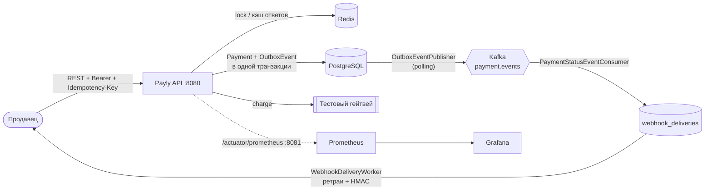
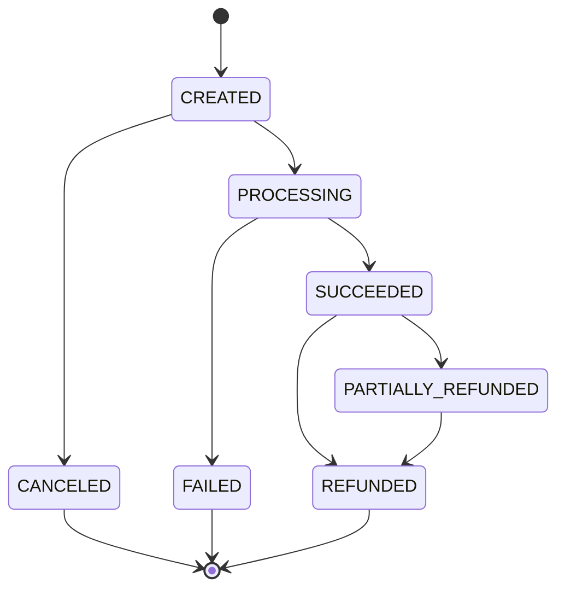

<div align="center">

# 💳 Payly

**Сервис приёма платежей для продавцов: REST API, идемпотентность, transactional outbox, подписанные вебхуки и наблюдаемость из коробки**


</div>

---

## 📖 Содержание

- [О проекте](#-о-проекте)
- [Возможности](#-возможности)
- [Архитектура](#-архитектура)
- [Быстрый старт](#-быстрый-старт)
- [API](#-api)
- [Тестовые карты](#-тестовые-карты)
- [Жизненный цикл платежа](#-жизненный-цикл-платежа)
- [Идемпотентность](#-идемпотентность)
- [Вебхуки](#-вебхуки)
- [Мониторинг](#-мониторинг)
- [Конфигурация](#-конфигурация)
- [Тестирование](#-тестирование)
- [Структура проекта](#-структура-проекта)

---

## 🧭 О проекте

**Payly** — бэкенд платёжного шлюза в духе Stripe. Продавец аутентифицируется по API-ключу, создаёт платежи по банковской карте, отменяет их, делает полные и частичные возвраты и получает уведомления о смене статусов на свой `webhook_url`.

Вместо реального эквайера работает **симулятор гейтвея в тестовом режиме**: исход списания определяется последними цифрами номера карты, как у тестовых карт Stripe.

## ✨ Возможности

| | |
|---|---|
| 💸 **Платежи** | создание, получение, список с фильтрами и пагинацией, отмена |
| ↩️ **Возвраты** | полные и частичные, с контролем остатка |
| 🔁 **Идемпотентность** | заголовок `Idempotency-Key`, распределённая блокировка в Redis, хранение ответов в Redis + PostgreSQL |
| 📤 **Transactional Outbox** | события пишутся в одной транзакции с платежом и публикуются в Kafka (at-least-once) |
| 🔔 **Вебхуки** | подпись HMAC-SHA256, экспоненциальные ретраи с джиттером (8 попыток за ~42 часа) |
| ✅ **Валидация** | алгоритм Луна, срок действия карты, список поддерживаемых валют |
| 🔐 **Безопасность** | аутентификация по Bearer API-ключу, изоляция данных продавцов |
| 📊 **Наблюдаемость** | Actuator на отдельном порту, бизнес-метрики Micrometer, Prometheus с алертами, готовый дашборд Grafana |
| 🧪 **Тесты** | unit, integration и e2e на Testcontainers |

## 🏗 Архитектура

Код разделён по **bounded context'ам** (`payment`, `refund`, `merchant`, `outbox`, `webhook`, `share`), каждый из которых устроен по слоям Clean Architecture:

```
domain/          — модели, перечисления, интерфейсы репозиториев и гейтвея
application/     — use case'ы (Create/Get/List/Cancel…), порты метрик
infrastructure/  — JPA, Kafka, REST-контроллеры, мапперы MapStruct, планировщики
```

### Поток данных



### Ключевые решения

- **Вызов гейтвея — вне транзакции.** Платёж создаётся и переводится в `PROCESSING` в первой транзакции, потом идёт поход в гейтвей (тестовая «медленная» карта отвечает ~30 с), а финализация — во второй транзакции. Соединение с БД на время внешнего вызова не держится.
- **Асинхронная финализация.** `PaymentProcessingScheduler` пачками доводит до финального статуса платежи, застрявшие в `PROCESSING`.
- **Outbox с порядком событий.** Ключ сообщения в Kafka — `aggregateId`, поэтому все события одного платежа попадают в одну партицию в порядке создания.
- **Отмена только из `CREATED`.** Платёж в `PROCESSING` уже ушёл в гейтвей — отменить его нельзя, можно только дождаться результата и сделать возврат.

## 🚀 Быстрый старт

### Требования

- Docker + Docker Compose
- JDK 21 (только для локального запуска без Docker и для тестов)

### Запуск всего стека

```bash
cp .env-example .env
```

```bash
docker compose up -d --build
```

| Сервис | Адрес |
|---|---|
| Payly API | http://localhost:8080 |
| Actuator (health, info, prometheus) | http://localhost:8081/actuator |
| Prometheus | http://localhost:9090 |
| Grafana (дашборд «Payly — обзор») | http://localhost:3000 — `admin` / `admin` |
| PostgreSQL | `localhost:5432` — `payly` / `payly` |
| Redis | `localhost:6379` |
| Kafka | `localhost:9092` |

Миграции Flyway применяются автоматически при старте приложения.

### Локальный запуск приложения

Поднимите только инфраструктуру и запустите приложение через Gradle:

```bash
docker compose up -d postgres redis kafka
```

```bash
./gradlew bootRun
```

> ℹ️ В `docker-compose.yml` Kafka анонсирует адрес `kafka:9092`. При запуске приложения на хосте добавьте `127.0.0.1 kafka` в `/etc/hosts` или поменяйте `KAFKA_ADVERTISED_LISTENERS`.

### Создание продавца

Публичного API регистрации продавцов пока нет — заведите продавца напрямую в БД:

```sql
INSERT INTO merchants (name, api_key_hash, webhook_url, webhook_secret)
VALUES ('Demo shop', 'sk_test_demo', 'https://example.com/webhooks', 'whsec_demo');
```

После этого запросы к API отправляются с заголовком `Authorization: Bearer sk_test_demo`.

> ⚠️ Сейчас `ApiKeyFilter` сравнивает Bearer-токен со значением `api_key_hash` как есть, без хэширования.

## 📡 API

Базовый путь: `/api/v1`. Все запросы требуют `Authorization: Bearer <api-key>`. Изменяющие запросы требуют заголовок `Idempotency-Key`.

| Метод | Путь | Описание | Idempotency-Key |
|---|---|---|:---:|
| `POST` | `/payment` | Создать платёж | ✅ |
| `GET` | `/payment/{id}` | Получить платёж | — |
| `GET` | `/payment` | Список платежей | — |
| `POST` | `/payment/{id}/cancel` | Отменить платёж | ✅ |
| `POST` | `/payment/{id}/refund` | Сделать возврат | ✅ |

### Создание платежа

```bash
curl -X POST http://localhost:8080/api/v1/payment \
  -H "Authorization: Bearer sk_test_demo" \
  -H "Idempotency-Key: 7c9e6679-7425-40de-944b-e07fc1f90ae7" \
  -H "Content-Type: application/json" \
  -d '{
    "amount": 150000,
    "currency": "RUB",
    "description": "Заказ #1042",
    "card": {
      "number": "4242424242424242",
      "expMonth": 12,
      "expYear": 2030,
      "cvc": "123"
    },
    "metadata": { "orderId": "1042" }
  }'
```

```json
{
  "id": "pay_3f2b8c1e9a4d4b7e8f0a1c2d3e4f5a6b",
  "amount": 150000,
  "currency": "RUB",
  "status": "SUCCEEDED",
  "description": "Заказ #1042",
  "cardLast4": "4242",
  "refundedAmount": 0,
  "metadata": { "orderId": "1042" },
  "createdAt": "2026-10-24T10:15:30.123Z"
}
```

**Правила валидации**

- `amount` — в минимальных единицах валюты (копейки, центы), от `1` до `100 000 000`;
- `currency` — из списка `PAYMENT_SUPPORTED_CURRENCIES` (по умолчанию `RUB`, `USD`, `EUR`);
- `card.number` — 12–19 цифр, проходит проверку по алгоритму Луна;
- `card.expMonth` / `card.expYear` — карта не просрочена;
- `card.cvc` — 3 цифры.

В БД сохраняются только последние 4 цифры карты.

### Список платежей

```bash
curl "http://localhost:8080/api/v1/payment?status=SUCCEEDED&createdFrom=2026-10-01T00:00:00Z&page=0&size=20&sort=createdAt,desc" \
  -H "Authorization: Bearer sk_test_demo"
```

Все фильтры необязательные: `status`, `createdFrom`, `createdTo` (ISO-8601). Пагинация — стандартные `page`, `size`, `sort`.

### Возврат

```bash
curl -X POST http://localhost:8080/api/v1/payment/pay_3f2b.../refund \
  -H "Authorization: Bearer sk_test_demo" \
  -H "Idempotency-Key: 1b4e28ba-2fa1-11d2-883f-0016d3cca427" \
  -H "Content-Type: application/json" \
  -d '{ "amount": 50000 }'
```

Если тело или `amount` не переданы, возвращается **весь остаток** платежа. Ответ — `201 Created`:

```json
{ "id": "re_9a8b7c...", "paymentId": "pay_3f2b...", "amount": 50000, "status": "SUCCEEDED", "createdAt": "..." }
```

### Ошибки

Все ошибки возвращаются в едином формате:

```json
{ "message": "Платёж уже обрабатывается", "status": "CONFLICT", "code": "payment_processing" }
```

| HTTP | Когда |
|---|---|
| `400` | ошибка валидации, нет `Idempotency-Key`, некорректная сумма возврата |
| `401` | нет или неверный API-ключ |
| `404` | платёж не найден или принадлежит другому продавцу |
| `409` | недопустимый переход статуса, платёж в обработке, запрос с этим ключом ещё выполняется, платёж нельзя вернуть |
| `422` | `Idempotency-Key` повторно использован с другим телом запроса |

## 🧪 Тестовые карты

Исход определяется по **последним 4 цифрам** номера (номер должен проходить проверку Луна):

| Номер карты | Результат | `failureReason` |
|---|---|---|
| `4242 4242 4242 4242` (любая другая) | ✅ `SUCCEEDED` | — |
| `4000 0000 0000 0002` | ❌ `FAILED` | `card_declined` |
| `4000 0000 0000 9995` | ❌ `FAILED` | `insufficient_funds` |
| `4000 0000 0000 0069` | ❌ `FAILED` | `expired_card` |
| `4000 0000 0000 0119` | ❌ `FAILED` | `processing_error` |
| `4000 0000 0000 3220` | ⏳ ответ через ~30 секунд, затем `SUCCEEDED` | — |

## 🔄 Жизненный цикл платежа



Переходы проверяет доменная модель (`PaymentStatus.canTransitionTo`), недопустимый переход возвращает `409`.

**События outbox:** `PAYMENT_CREATED`, `PAYMENT_SUCCEEDED`, `PAYMENT_FAILED`, `PAYMENT_CANCELLED`, `REFUND_SUCCEEDED`.

## 🔁 Идемпотентность

Методы с аннотацией `@Idempotent` обрабатывает `IdempotencyAspect`:

1. Берётся распределённая блокировка `idem-lock:{merchantId}:{key}` в Redis (TTL 30 с). Если она занята — `409 idempotency_request_in_progress`.
2. Ищется сохранённый ответ: сначала в Redis, затем в PostgreSQL (`idempotency_records`).
3. Если ответ найден и SHA-256 тела совпадает — тот же ответ отдаётся повторно с заголовком `Idempotent-Replayed`. Если хэш другой — `422 idempotency_key_reused`.
4. Иначе выполняется операция, и её ответ (кроме `5xx`) сохраняется в БД и кэшируется в Redis на 24 часа.

Ключи уникальны в рамках продавца.

## 🔔 Вебхуки

Событие проходит путь `outbox_events → Kafka (payment.events) → webhook_deliveries → HTTP POST на webhook_url продавца`.

**Формат запроса**

```json
{
  "id": "evt_5d9c...",
  "type": "PAYMENT_SUCCEEDED",
  "createdAt": "2026-10-24T10:15:31Z",
  "data": {
    "object": {
      "paymentId": "pay_3f2b...",
      "merchantId": "8b1f...",
      "amount": "150000",
      "currency": "RUB",
      "status": "SUCCEEDED"
    }
  }
}
```

**Подпись** передаётся в заголовке `X-Signature`:

```
X-Signature: t=1761300931,v1=5257a869e7ecebeda32affa62cdca3fa51cad7e77a0e56ff536d0ce8e108d8bd
```

где `v1 = HMAC-SHA256(webhook_secret, "{t}.{raw_body}")` в hex. Чтобы проверить подпись на своей стороне, вычислите тот же HMAC и сравните его в constant-time, а также проверьте, что `t` не слишком старый.

**Ретраи.** Успехом считается любой ответ `2xx`. При ошибке или таймауте (5 с на соединение, 10 с на чтение) следующая попытка планируется через:

`1 мин → 5 мин → 30 мин → 2 ч → 5 ч → 10 ч → 24 ч` (±20% джиттер)

После 8-й неудачной попытки доставка переходит в `FAILED`. Если у продавца не задан `webhook_url`, доставка сразу помечается как `FAILED`.

## 📊 Мониторинг

Actuator работает на **отдельном внутреннем порту `8081`** (без API-ключа). Если вернуть его на общий порт, `prometheus` и `metrics` автоматически закрываются.

| Эндпоинт | Назначение |
|---|---|
| `/actuator/health/liveness` | состояние процесса |
| `/actuator/health/readiness` | готовность принимать трафик (БД + Redis) |
| `/actuator/info` | версия, время сборки, JVM, ОС |
| `/actuator/prometheus` | метрики для Prometheus |

### Бизнес-метрики

| Метрика | Тип | Описание |
|---|---|---|
| `payly_payments_initiated_total` | counter | созданные платежи (по валюте) |
| `payly_payments_finalized_total` | counter | финализированные платежи (статус, причина, sync/async, валюта) |
| `payly_payments_succeeded_amount` | summary | оборот успешных платежей |
| `payly_payments_canceled_total` | counter | отменённые платежи |
| `payly_payment_gateway_charge_seconds` | histogram | время ответа гейтвея |
| `payly_outbox_events_pending` | gauge | бэклог неопубликованных событий outbox |
| `payly_outbox_events_published_total` | counter | попытки публикации в Kafka |
| `payly_outbox_events_lag_seconds` | timer | задержка от записи события до публикации |
| `payly_webhook_delivery_attempt_seconds` | histogram | попытки доставки вебхуков |
| `payly_webhook_deliveries_failed_total` | counter | вебхуки, доставку которых прекратили |

### Алерты Prometheus

- **PaylyDown** — сервис недоступен;
- **PaylyOutboxBacklog** — больше 100 неопубликованных событий в outbox;
- **PaylyHighDeclineRate** — высокая доля отказов;
- **PaylyGatewaySlow** — гейтвей отвечает медленно.

### Дашборд Grafana

Дашборд **«Payly — обзор»** подключается автоматически и открывается на главной. Разделы: обзор (платежи, доля успешных, оборот, возвраты), платежи и причины отказов, платёжный гейтвей, outbox и вебхуки, HTTP API (RPS, ошибки, p95), JVM и пул соединений HikariCP.

## ⚙️ Конфигурация

Основные переменные окружения (см. [`.env-example`](.env-example)):

| Переменная | По умолчанию | Описание |
|---|---|---|
| `PAYMENT_SUPPORTED_CURRENCIES` | `RUB,USD,EUR` | поддерживаемые валюты (ISO 4217) |
| `PAYMENT_PROCESSING_MIN_DELAY_SECONDS` | `1` | мин. задержка асинхронной обработки |
| `PAYMENT_PROCESSING_MAX_DELAY_SECONDS` | `5` | макс. задержка асинхронной обработки |
| `PAYMENT_PROCESSING_BATCH_SIZE` | `100` | размер пачки планировщика платежей |
| `PAYMENT_PROCESSING_POLL_INTERVAL_MS` | `1000` | интервал опроса планировщика платежей |
| `OUTBOX_PUBLISHER_TOPIC` | `payment.events` | Kafka-топик событий |
| `OUTBOX_PUBLISHER_BATCH_SIZE` | `100` | размер пачки outbox-публикатора |
| `OUTBOX_PUBLISHER_POLL_INTERVAL_MS` | `5000` | интервал опроса outbox |
| `MANAGEMENT_SERVER_PORT` | `8081` | порт Actuator (должен отличаться от порта API) |
| `GRAFANA_ADMIN_USER` / `GRAFANA_ADMIN_PASSWORD` | `admin` / `admin` | учётная запись Grafana |

Подключение к инфраструктуре настраивается стандартными свойствами Spring: `SPRING_DATASOURCE_*`, `SPRING_DATA_REDIS_*`, `SPRING_KAFKA_BOOTSTRAP_SERVERS`.

## 🧪 Тестирование

Тесты разделены на три уровня и помечены JUnit-тегами. Для integration и e2e нужен запущенный Docker (Testcontainers поднимает PostgreSQL и Kafka).

| Уровень | Что проверяет | Команда |
|---|---|---|
| **unit** | use case'ы, валидаторы, подпись и ретраи вебхуков, метрики (Mockito, без Spring) | `./gradlew unitTest` |
| **integration** | MockMvc + Testcontainers: платежи, возвраты, конкурентные возвраты, откат отмены, outbox, consumer | `./gradlew integrationTest` |
| **e2e** | реальный HTTP-сервер: полные сценарии API, доставка вебхуков, Actuator | `./gradlew e2eTest` |

Все тесты сразу:

```bash
./gradlew test
```

## 📁 Структура проекта

```
payly/
├── src/main/kotlin/com/payly/
│   ├── payment/        # платежи: модель, use case'ы, гейтвей, планировщик, REST
│   ├── refund/         # возвраты
│   ├── merchant/       # продавцы
│   ├── outbox/         # transactional outbox и публикация в Kafka
│   ├── webhook/        # consumer событий, доставка и подпись вебхуков
│   └── share/          # безопасность, идемпотентность, валидация, обработка ошибок
├── src/main/resources/
│   ├── application.yaml
│   └── db/migration/   # миграции Flyway V1–V6
├── src/test/kotlin/com/payly/
│   ├── unit/ · integration/ · e2e/
│   └── support/        # базовые классы, Testcontainers, фикстуры
├── monitoring/
│   ├── prometheus/     # конфиг скрейпа и правила алертов
│   └── grafana/        # provisioning и дашборд
├── Dockerfile          # multi-stage сборка (JDK 21 → JRE 21 Alpine)
└── docker-compose.yml  # app + Postgres + Redis + Kafka + Prometheus + Grafana
```

### Схема БД

| Таблица | Назначение |
|---|---|
| `merchants` | продавцы, API-ключи, URL и секрет вебхуков |
| `payments` | платежи (`pay_…`), статус, сумма возвратов, оптимистическая блокировка `version` |
| `refunds` | возвраты (`re_…`) |
| `outbox_events` | события для публикации в Kafka |
| `idempotency_records` | сохранённые ответы идемпотентных запросов |
| `webhook_deliveries` | очередь доставки вебхуков с ретраями |

---

<div align="center">

Сделано с ❤️ на Kotlin и Spring Boot

</div>
